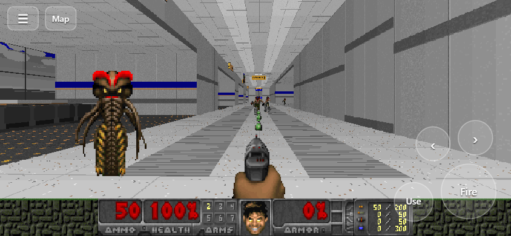
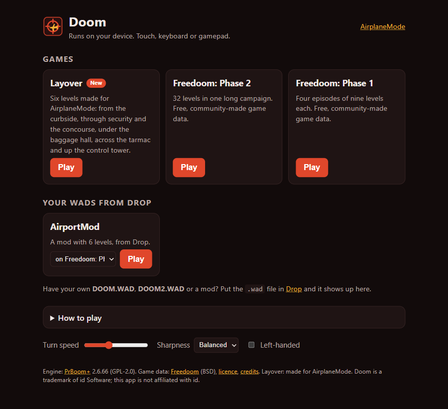

<p align="center"></p>

# Doom on AirplaneMode

An [AirplaneMode](https://github.com/jessewolcott/airplanemode) app. The classic shooter, played
on the phones, tablets and laptops on the hotspot with no internet. The game runs **in the
browser** (PrBoom+ compiled to WebAssembly); the box only serves files.

<p align="center">
  
</p>
<p align="center">
  
</p>

<sub>Screenshots from the laptop dev stack; not yet tested on real phones or hardware.</sub>

- **Touch controls.** Left thumb moves (push further to run), right thumb drags to turn,
  plus Fire, Use, weapon and map buttons. When a menu or a yes/no question is up, the
  controls switch to arrows, OK and Back. Left-handed layout and turn speed are on the start
  page. Keyboard and mouse, and gamepads, work too.
- **Games you can play right away:** *Layover* (below), *Freedoom: Phase 1* and *Phase 2*
  (complete, free games).
- **Your own WADs.** Put `DOOM.WAD`, `DOOM2.WAD` or any mod's `.wad` in
  [Drop](https://github.com/jessewolcott/airplanemode-drop). It appears on the start page
  (full games as games; mods with a choice of game to run on), and Drop shows a
  **Play in Doom** button on it.
- **Saves stay in the browser** (IndexedDB), separately for each game.

## Layover: an airport episode

Six levels made for AirplaneMode, from code in [`wad/`](wad/): maps, textures, signs, title
screen and all. It plays on top of Freedoom: Phase 2 (its monsters, weapons and sounds).

| | Level | |
|---|---|---|
| 1 | **Curbside** | Drop-off lane and shuttle bus, the check-in hall, the airline office with your boarding pass (blue key), out through security. |
| 2 | **Security** | The checkpoint is in lockdown: queue lanes, x-ray machines, a staff lift up to the security office that overlooks airside, the crew badge in confiscated goods. |
| 3 | **Concourse B** | Moving walkways, four gates, two jet bridges into plane cabins, a food court whose kitchen wakes up while you're on board, and a trap in the lounge. |
| 4 | **Baggage Underworld** | Baggage claim carousels you can ride, then the belts under the terminal: a conveyor into a crusher, the sorting hall, lost luggage (red key). |
| 5 | **The Tarmac** | Out on the apron among the parked airliners (climb onto the wings), a fuel depot, and the hangar. |
| 6 | **Control Tower** | Up the stair shaft and into the glass cab. Something waits on the roof; the radar mast opens when it's dead. |

Top-down views (generated by the build): [1](docs/maps/map01.png) · [2](docs/maps/map02.png) ·
[3](docs/maps/map03.png) · [4](docs/maps/map04.png) · [5](docs/maps/map05.png) ·
[6](docs/maps/map06.png).

### How the maps are made

Each map is a Python file in [`wad/maps/`](wad/maps/) that places rooms as polygons; the kit
([`wad/mapkit.py`](wad/mapkit.py)) turns them into Doom lines and sectors (shared edges
become openings, the rest walls; doors, lifts, windows, teleporters and scrollers get their
specials and textures). Every build **checks each map**: things inside the map and not stuck
in walls, no overlapping sectors, and the exit reachable from the start with the keys that can
be found. [`zdbsp`](https://github.com/rheit/zdbsp) builds the nodes. Textures are drawn in
code too ([`wad/art.py`](wad/art.py)), in colours Doom's palette can show.

```sh
pip install -r wad/requirements.txt          # Pillow; plus `apt install zdbsp` for nodes
python wad/build.py --iwad freedoom2.wad --out layover.wad --preview build/preview
python wad/test_wad.py                       # tools and maps (CI runs this)
```

## Running it

On the box it's part of the platform stack at `/doom/`. For development:

```sh
docker compose up -d --build        # http://localhost:8771 (no Drop standalone)
```

or with the whole platform (Drop integration included), from `../airplanemode`:
`docker compose -f compose.yaml -f compose.dev.yaml up -d --build`.

The image build ([`Dockerfile`](Dockerfile)):

1. **Engine:** PrBoom+ 2.6.66 (pinned commit) with Emscripten: software renderer, SDL2,
   OPL music (no sound fonts needed), patched by [`engine/patch.py`](engine/patch.py) for the
   browser's main loop, plus the touch glue in [`engine/am_web.c`](engine/am_web.c).
2. **Freedoom 0.13.0**, checksum-pinned.
3. **Layover**, built and checked as above.
4. **Static site** on busybox httpd (gzip copies, so Freedoom: Phase 2 is ~11 MB over the
   air). Memory limit 32 MB.

Stages 1-3 run once on the build machine; only the last stage is per architecture.

## Licences

- This repo: **GPL-2.0-or-later** ([LICENSE](LICENSE)), like PrBoom+ which it builds. That
  includes the Layover maps and art it generates.
- [PrBoom+](https://github.com/coelckers/prboom-plus): GPL-2.0-or-later.
- [Freedoom](https://freedoom.github.io/): BSD-3-Clause (shipped with its `COPYING.txt` and
  credits, linked from the page).
- Doom is a trademark of id Software. This project is not affiliated with id Software or
  ZeniMax, and ships none of their game data.
